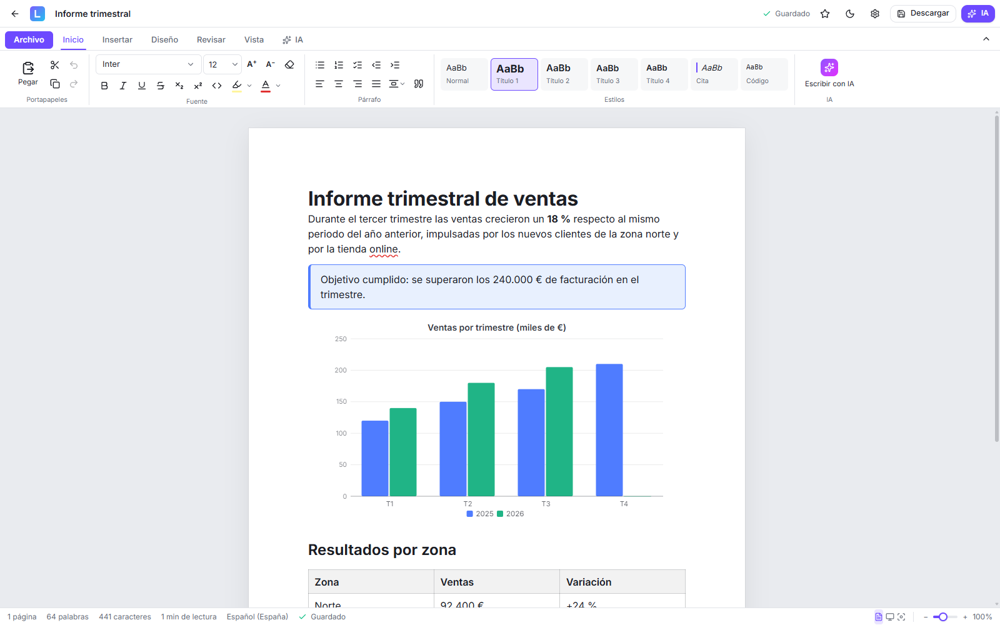
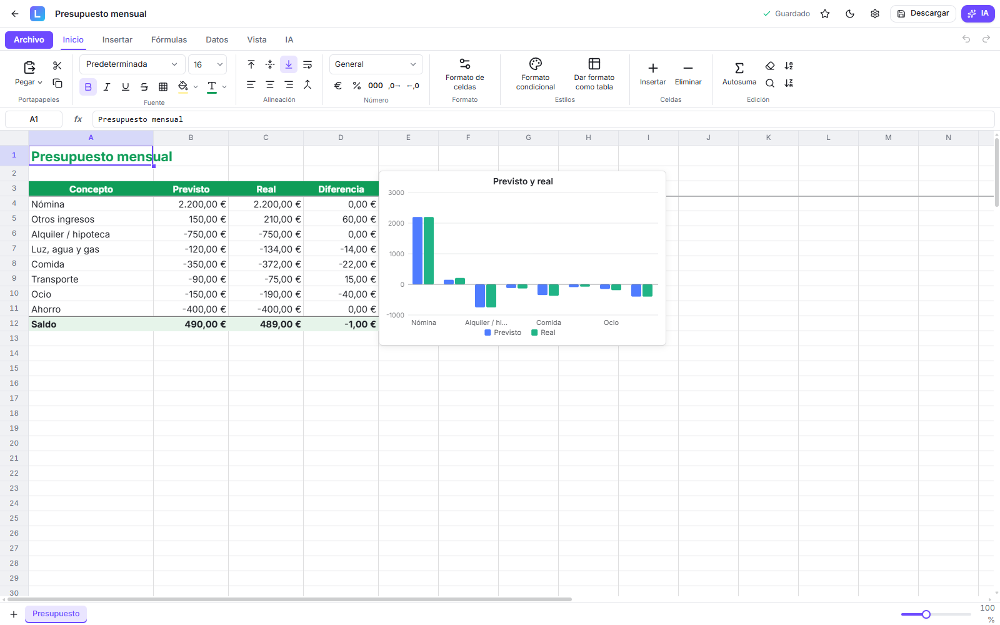
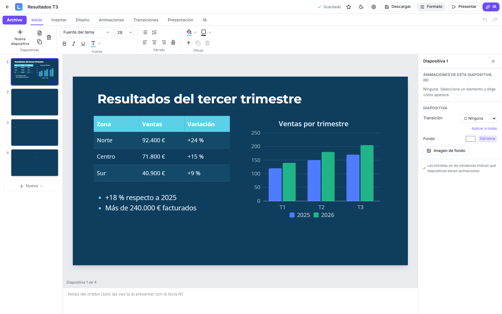
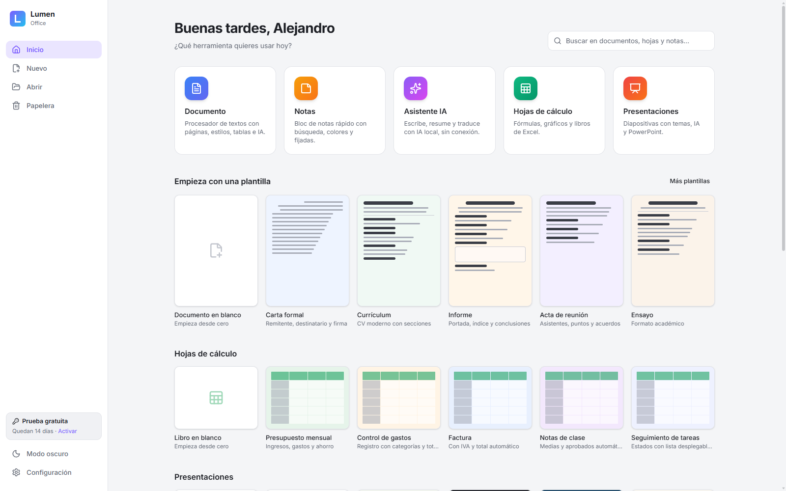
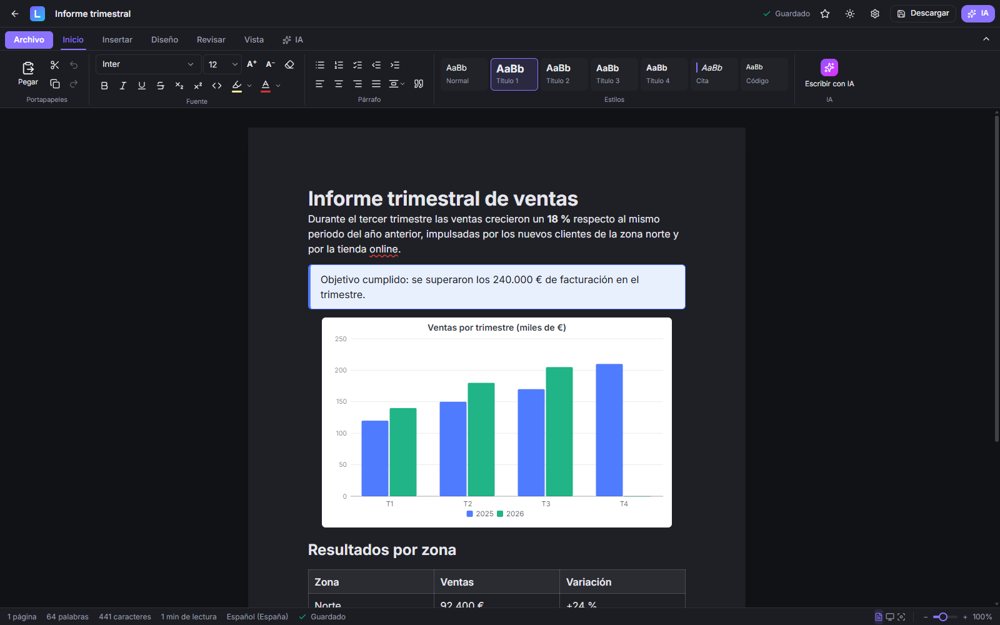

# Lumen Office

[](https://github.com/ZaperMaster/lumen-office/actions/workflows/tests.yml)
[](https://github.com/ZaperMaster/lumen-office/releases/latest)

[](LICENSE)
[](https://zapermaster.github.io/lumen-office/)

Suite ofimática de escritorio para Windows con **Documentos** (procesador de textos tipo Word), **Hojas de cálculo**
(tipo Excel), **Presentaciones** (tipo PowerPoint), **Notas** y un **Asistente de IA** que puede funcionar por completo en tu equipo.
Hecha con **TypeScript + React + Tiptap** y empaquetada como app de escritorio con **Tauri 2**.

**Descargar:** [última versión](https://github.com/ZaperMaster/lumen-office/releases/latest) → `Lumen.Office_x.y.z_x64-setup.exe`.
Una vez instalada, la app se actualiza sola. Novedades de cada versión: [CHANGELOG.md](CHANGELOG.md). Web del proyecto: **[zapermaster.github.io/lumen-office](https://zapermaster.github.io/lumen-office/)**.

## Capturas

<p align="center">
  
</p>

| Hojas de cálculo | Presentaciones |
|---|---|
|  |  |

| Inicio | Modo oscuro |
|---|---|
|  |  |

## Qué incluye

**Inicio tipo Office**
- Elegir herramienta (Documento, Hoja de cálculo, Presentación, Notas, Asistente IA), plantillas con miniatura,
  recientes, búsqueda y papelera.

**Documentos**
- Cinta de opciones: Archivo, Inicio, Insertar, Diseño, Revisar, Vista, IA y la pestaña contextual Tabla.
- Hoja con tamaño, márgenes y orientación reales; saltos de página; vistas de impresión, web y enfoque; zoom.
- Fuentes, tamaños, colores, resaltado, estilos, listas, tareas, tablas, citas y código.
- **Imágenes editables**: tamaño con tiradores, texto alrededor (izquierda/derecha) o centradas, mover arrastrando,
  recortar, girar, voltear y texto alternativo.
- **Vínculos**: Ctrl+clic para abrirlos y menú para abrir, editar, copiar o quitar.
- Buscar y reemplazar, contador de palabras y menú flotante sobre la selección.
- **Corrector ortográfico en español** con sugerencias, diccionario personal e «Ignorar».
- **Comentarios** (responder, resolver) y **control de cambios** (aceptar o rechazar), también al abrir y guardar Word.
- **Gráficos** con tus datos, **cuadros de texto**, **notas al pie** y texto en **columnas**.

**Hojas de cálculo**
- Fórmulas con nombres en español o inglés (SUMA, SI, BUSCARV, SUMAR.SI.CONJUNTO…), sugerencias al escribir y
  referencias con el ratón; varias hojas por libro.
- Formatos de número (€, %, fechas), estilos, bordes, combinar celdas, inmovilizar, ocultar filas y columnas.
- Relleno de series, copiar y pegar (también desde Excel), ordenar, filtros, quitar duplicados, buscar y reemplazar.
- Formato condicional (reglas, barras de datos, escalas de color), formato de tabla, listas desplegables y comentarios.
- Gráficos (columnas, barras, líneas, área, circular, anillo, dispersión) y tablas dinámicas.
- IA: escribir fórmulas, analizar datos y generar tablas. Abre y guarda Excel (.xlsx) y CSV.
- Los gráficos se guardan dentro del archivo de Excel; **minigráficos** en las celdas.
- **Configurar página** (orientación, márgenes, ajustar al ancho, filas que se repiten, área de impresión).
- **Proteger hoja** y desbloquear celdas.

**Presentaciones**
- Diapositivas con diseños, 8 temas, textos, imágenes y formas que se mueven, redimensionan y giran.
- Transiciones, animaciones, notas del orador y modo presentación a pantalla completa (F5).
- IA: crear una presentación entera a partir de un tema y escribir las notas del orador.
- **Tablas y gráficos** en las diapositivas.
- **Vista del moderador**: en tu pantalla las notas, la siguiente diapositiva y el cronómetro; en el proyector, solo la
  diapositiva (Alt+F5).
- Abre y guarda PowerPoint (.pptx); imprimir, PDF y **vídeo MP4**.

**Archivos, como en Word**
- **Guardar** (Ctrl+S) reemplaza el archivo vinculado; **Guardar como** (F12) elige carpeta, nombre y formato.
- **Exportar una copia** a Word (.docx), Lumen (.lumen, sin pérdidas), Markdown, HTML, texto o **PDF de un clic**.
- **Abrir archivo** (Ctrl+O): .docx, .xlsx, .csv, .pptx, .lumen, .md, .html y .txt. Los **PDF** se convierten en un documento editable.
- **Autoguardado en el archivo** y aviso **Guardar / No guardar / Cancelar** al salir o cerrar con cambios pendientes.

**Notas**
- Búsqueda, colores, etiquetas, fijadas, favoritas y guardado automático.

**Personalización**
- 10 temas (claro, oscuro, medianoche, grafito, sepia, bosque, océano, rosa, lavanda, alto contraste), color de acento,
  18 fuentes incluidas más las del sistema, esquinas y hoja blanca u oscura.
- Ventana con barra de título integrada en el diseño de la app.

## IA

Se elige en **Configuración → Inteligencia artificial**:

| Motor | Dónde se ejecuta | Notas |
|---|---|---|
| **Integrado** (WebLLM + WebGPU) | En tu tarjeta gráfica | Sin conexión y sin enviar nada. El modelo se descarga una vez (por defecto Qwen 2.5 1.5B, ~0,9 GB, licencia Apache 2.0). Todos los modelos ofrecidos permiten el uso comercial (Apache 2.0 o Llama 3.2 Community License, «Built with Llama»); la licencia se indica al elegirlo. |
| **Ollama** | En tu equipo | Usa los modelos instalados con [Ollama](https://ollama.com). |
| **Tu propia API** | En el servicio que elijas | OpenAI, OpenRouter, Groq, DeepSeek, Mistral, LM Studio o Anthropic. El texto se envía a ese servicio. |

Acciones sobre la selección (mejorar, corregir, acortar, ampliar, tono, traducir, lista, tabla, resumir, continuar) con
vista previa antes de aplicar, y chat con el documento como contexto.

**Memoria:** con la IA local en uso, el modelo ocupa unos 2,5–3 GB. Por defecto se libera solo tras 5 minutos sin
usarlo; se puede desactivar para que responda más rápido. Sin el modelo cargado, la app ocupa unos 350 MB.

## Desarrollo

```bash
npm install
npm run dev          # en el navegador: http://localhost:5173
npm run tauri dev    # como app de escritorio
npm run tauri build  # instaladores en src-tauri/target/release/bundle
npm test             # pruebas automáticas (también se ejecutan antes de publicar)
```

La página web de la app está en `docs/` (se puede servir con GitHub Pages desde la carpeta `/docs`).

Requisitos: Node.js 20+, Rust (`winget install Rustlang.Rustup`) y Visual Studio Build Tools con
«Desarrollo de escritorio con C++».

### Publicar una versión

1. Sube la versión en `package.json`, `src-tauri/tauri.conf.json`, `src-tauri/Cargo.toml` (y «Acerca de»).
2. Escribe las novedades en un archivo, por ejemplo `notas.md`.
3. Ejecuta:

```bash
npm run release -- --notes notas.md
```

El script compila los instaladores **firmados**, genera `latest.json` y crea la Release en GitHub. Las apps instaladas
la detectan solas. Con `--dry-run` compila y genera `latest.json` sin publicar.

La firma usa la clave privada de `%USERPROFILE%\.tauri\lumen-office.key` (y su contraseña en
`lumen-office.key.password`). **No la subas nunca al repositorio y guarda una copia de seguridad**: sin ella no se
pueden publicar actualizaciones que las apps instaladas acepten.

### Estructura

```
src/
  App.tsx                      enrutado, avisos, cierre seguro y actualizaciones
  lib/
    files.ts / closeGuard.ts   guardar, abrir, exportar, autoguardado y aviso al cerrar
    io.ts                      conversión DOCX, Markdown, HTML, TXT y .lumen
    ai.ts                      acciones de IA y elección de motor
    localAI.ts / llm-worker.ts motor local (WebLLM en un worker)
    remoteAI.ts                Ollama y APIs (OpenAI-compatible y Anthropic)
    updater.ts                 actualizaciones automáticas
    db.ts                      base de datos local (IndexedDB con Dexie)
  components/
    launcher/  editor/  notes/  ai/  ui/
scripts/release.mjs            publicación de versiones
src-tauri/                     app de escritorio (Rust)
```

## Idiomas

La app viene en **español**. La primera vez que se abre deja elegir idioma, y se puede cambiar en
**Configuración → Idioma**. Los demás idiomas **no vienen dentro de la app**: se descargan de la web
(`docs/lang/<código>.json`, unos 70 KB cada uno) solo cuando alguien los elige, y se guardan en el equipo.

Cómo funciona en el código:

- Los textos de la interfaz están en español dentro de `L("…")` (`src/lib/i18n.ts`). Ese texto es la clave: si un
  idioma no tiene traducción para él, se ve en español.
- `node scripts/i18n-wrap.mjs --catalog` genera `scripts/i18n/catalog.json` con todos los textos de la app.
- Las traducciones de cada idioma están en `scripts/i18n/<código>/*.json` (`{ "texto en español": "traducción" }`).
- `node scripts/i18n-pack.mjs <código> scripts/i18n/<código>/*.json` crea `docs/lang/<código>.json` y dice qué falta.
- `docs/lang/index.json` es la lista de idiomas que ofrece la app. **Para añadir un idioma no hace falta publicar una
  versión nueva**: basta con subir su paquete y añadirlo a esa lista.

Las pruebas (`tests/i18n.test.ts`) comprueban que los paquetes no traducen textos que ya no existen y que conservan los
marcadores `{0}`, `{1}`…

## Datos y privacidad

Documentos, notas y ajustes se guardan en tu equipo. La app solo puede escribir en las carpetas que elijas en la
ventana de Windows. Desde **Configuración → General y datos** se puede exportar e importar una copia de seguridad.

## Activación

Lumen Office es un **proyecto personal; no se vende**. Aun así, incluye un sistema de activación completo, como el de
cualquier programa profesional, porque forma parte de la app:

1. **Periodo de prueba de 14 días.** Empieza la primera vez que se abre la app y, durante ese tiempo, todo funciona.
   La fecha de inicio se guarda en dos sitios del equipo, y si el reloj del sistema se atrasa para alargar la prueba,
   la app lo detecta.
2. **Clave de activación.** Pasados los 14 días, la app pide una clave (también se puede poner antes, en
   Configuración → Licencia). Las claves empiezan por `LUMEN1-` y llevan el nombre de su titular.
3. **Comprobación sin conexión.** Cada clave está **firmada digitalmente** (Ed25519) con la clave privada del autor.
   La app solo contiene la clave pública, así que puede comprobar que una clave es auténtica sin conectarse a ningún
   servidor, y nadie puede fabricar claves válidas.
4. **Tus datos no se bloquean.** Sin clave, la app deja de editar, pero los documentos siguen en el equipo y desde la
   pantalla de activación se puede sacar una copia de seguridad.

Las claves las da el autor; puedes pedirla abriendo un *issue* en este repositorio.

Para el autor, las claves se crean con `scripts/license.mjs` (la clave privada de firma vive fuera del proyecto,
en `%USERPROFILE%\.lumen\`, y nunca se sube al repositorio):

```bash
node scripts/license.mjs crear --nombre "Nombre del cliente" --email cliente@ejemplo.com
```

## Licencia

[PolyForm Strict 1.0.0](LICENSE) © 2026 Alejandro Zapata. Todos los demás derechos reservados.

- **Sí se puede:** descargar y usar Lumen Office gratis para cualquier fin no comercial (uso personal, estudio,
  organizaciones sin ánimo de lucro…) y leer su código.
- **No se puede:** venderla ni usarla con fines comerciales, ni usar su código (copiarlo, modificarlo o reutilizarlo
  en otros proyectos) ni redistribuirla.
